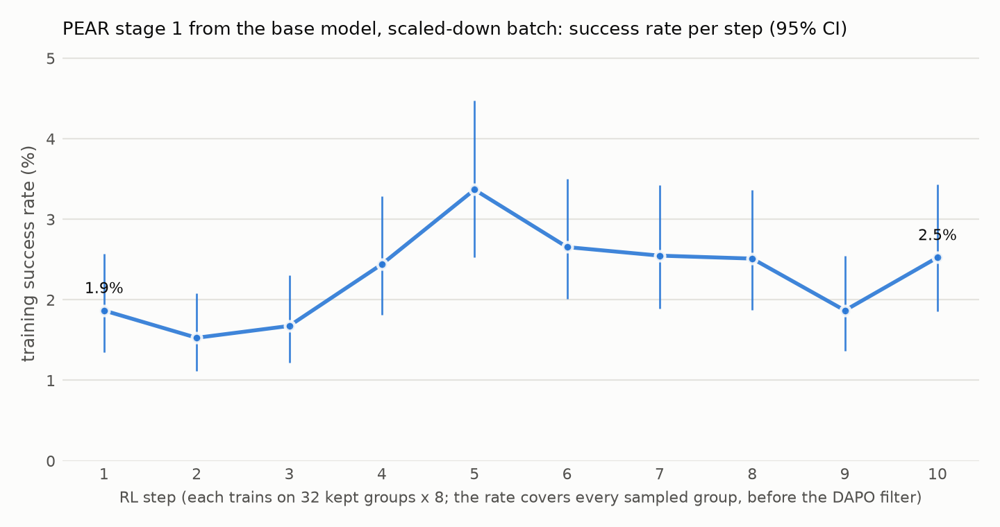

# PEAR reproduction on a small budget

An independent reproduction of PEAR ([arXiv 2611.18562](https://arxiv.org/abs/2611.18562)) with this repository's
code at `d604856`. The only code change is a `GPU=gb200` profile (the other commit on this branch). Two questions:

1. Do the released checkpoints score what Table 2 reports? **Yes, within sampling error** (section 1).
2. Does RL from the base model show the early rise of Figure 3a? **It has started to rise.** After 15 of the paper's
   148 stage-1 steps, at a quarter of the paper's batch, the training success rate is about 3.9% (steps 12-15), up from
   about 1.7% (steps 1-3) (section 2). A 120-episode LIBERO evaluation of the step-15 checkpoint is too small to show
   this rise: it scores 3.3%, against 4.2% for the base model, with overlapping intervals.

Status (2026-11-19): stage-1 RL was stopped after step 15, and the step-15 checkpoint was evaluated (section 2).

## 1. Released checkpoints on LIBERO

Protocol: `eval_libero.sh` unchanged, xhigh effort, 120 episodes per model (4 suites x 10 tasks x trials 0-2), on
GB300 nodes. Intervals are Wilson 95%.

| Model | This reproduction | Paper (Table 2) |
|---|---|---|
| Base `Qwen/Qwen3.8-27B` (revision `1d4bf0f`) | 4.2% (1.8-9.4) | 1.6% |
| `Qwen3.8-27B-PEAR-LIBERO_only` | 70.0% (61.3-77.5) | 74.4% |
| ... Spatial / Object / Goal / Long | 80.0 / 96.7 / 56.7 / 46.7 | 85.8 / 97.0 / 61.4 / 53.2 |
| `Qwen3.8-27B-PEAR` (final) | 71.7% (63.0-79.0) | not reported separately |

Every paper number lies inside our interval. With 30 episodes per suite, the per-suite numbers are only a rough check.
This confirms the end point of training, not the training itself. The full 2,000-episode evaluation was not run.

## 2. RL from the base model (stage 1, scaled down)



| Step | Judged groups | Trajectories | Success rate (95% CI) | Groups with a success | Step time |
|---|---|---|---|---|---|
| 1 | 241 | 1,928 | 1.9% (1.4-2.6) | 13.3% | 52 min |
| 2 | 319 | 2,552 | 1.5% (1.1-2.1) | 10.0% | 47 min |
| 3 | 276 | 2,208 | 1.7% (1.2-2.3) | 11.6% | 42 min |
| 4 | 215 | 1,720 | 2.4% (1.8-3.3) | 14.9% | 30 min |
| 5 | 167 | 1,336 | 3.4% (2.5-4.5) | 19.2% | 30 min |
| 6 | 226 | 1,808 | 2.7% (2.0-3.5) | 14.2% | 31 min |
| 7 | 206 | 1,648 | 2.5% (1.9-3.4) | 15.5% | 36 min |
| 8 | 214 | 1,712 | 2.5% (1.9-3.4) | 15.0% | 36 min |
| 9 | 261 | 2,088 | 1.9% (1.4-2.5) | 12.3% | 37 min |
| 10 | 193 | 1,544 | 2.5% (1.9-3.4) | 16.6% | 37 min |
| 11 | 216 | 1,728 | 2.7% (2.0-3.5) | 14.8% | 32 min |
| 12 | 151 | 1,208 | 3.3% (2.4-4.5) | 21.2% | 32 min |
| 13 | 150 | 1,200 | 3.2% (2.4-4.4) | 21.3% | 23 min |
| 14 | 130 | 1,040 | 5.6% (4.3-7.1) | 25.4% | 28 min |
| 15 | 145 | 1,160 | 3.4% (2.5-4.7) | 21.4% | 24 min |

- **What is plotted:** the success rate of training rollouts, as in the thin line of the paper's Figure 3a. It is
  `training/filter_groups/avg@n`: every trajectory of every group sampled in that step, before the DAPO group filter.
  The recipe has no in-training evaluation (`test_freq: -1`).
- **Per-step counts** are reconstructed from the logged metrics; `plot_s2_curve.py` explains how. The intervals treat
  trajectories as independent. The 8 trajectories of a group share a task, so the true intervals are wider.
- **Reading so far:** the rate has roughly doubled, though not monotonically.
  - Steps 1-3 average about 1.7%, with 10-13% of groups having a success.
  - Steps 12-15 average about 3.9%, with 21-25% of groups having a success.
  - Step 14's interval (4.3-7.1%) lies entirely above steps 1-3. At the group level, 25% (33 of 130) is above step
    2's 10% (32 of 319) too.
  - Step 9 dipped to 1.9% along the way.
  - The paper reports about 2% rising to about 70% within 148 steps of 128 groups. Fifteen of our steps train on as
    many kept groups as 3.75 of the paper's steps, so a slope comparison is still premature.
  - Fewer groups need to be sampled per step as more of them are kept, so steps are getting faster: 23-28 minutes for
    steps 13-15, against 42-52 minutes for steps 1-3.

**Mid-run checkpoint.** The step-15 checkpoint was exported with `scripts/export_checkpoint.sh` to a Hugging Face
model directory, which a recipe takes as `MODEL`. It is bf16, except `visual` and `A_log`, which stay fp32 as the run's
`rollout.fp32_modules` names them. It has no `mtp.*` tensors: training does not update the multi-token-prediction
head, and the recipe decodes without speculation. The weights are not published here.

**Evaluation of the step-15 checkpoint.** The protocol is that of section 1: the same 120 episodes, xhigh effort, and
the same Hydra overrides apart from the model path. It ran on 2 GB200 nodes; section 1 ran on GB300.

| Model | All (95% CI) | Goal | Spatial | Object | Long |
|---|---|---|---|---|---|
| Base | 5/120 = 4.2% (1.8-9.4) | 4/30 | 1/30 | 0/30 | 0/30 |
| RL step 15 | 4/120 = 3.3% (1.3-8.3) | 1/30 | 1/30 | 2/30 | 0/30 |

- At this size, the evaluation cannot tell the two models apart. It cannot confirm or rule out the rise in the training
  rate, which is measured on 1,040-2,552 trajectories per step.
- It agrees with the training rate at step 15, 3.4% (2.5-4.7).
- Fewer episodes ended on an answer the parser could not read: 2 of 120, against 7 for the base.
- It also shows that the exported checkpoint loads and runs in the recipe's rollout.

## 3. Differences from the paper's stage 1

- **Batch:** 32 groups x 8 rollouts per step, counted after the group filter (paper: 128 x 8). The mini-batch is the
  whole batch, with one update per step and learning rate 1e-6, as in the recipe. Each update sees a quarter of the
  data, so gradients are noisier and progress per step is not directly comparable.
- **Hardware:** GB200 (186 GB per GPU) instead of GB300 (288 GB). The layout is the same: vLLM with tensor
  parallelism 2 for rollout; FSDP4 x SP4 with FlashAttention-4 for training. Two settings change:
  - The per-GPU dynamic micro-batch cap is 41,024 tokens (one maximum-length trajectory per SP group) instead of
    69,632. This only changes how a batch is split into micro-batches.
  - Each vLLM replica runs 36 sessions (the repository default is 32). This only changes throughput.
- **Scale:** 2 trainer nodes and 10 rollout nodes, 4 GPUs each, so training data parallelism is 2.
- **Segmented run:** the run is split into jobs of at most 2 hours. Each job resumes from the latest checkpoint,
  including the in-flight rollouts that the transfer queue saves with it (`save_freq: 1`).
  - Two jobs were cut short: one because a step would not finish before the time limit, one because a checkpoint save
    hung on a storage fault.
  - Both resumed from the last complete checkpoint. No step was trained twice or skipped, but the rollouts from the
    cut-short part were discarded.
- **Length:** the first 15 steps of stage 1. The paper runs 148 steps on Goal, Spatial and Object, then adds Long
  (steps 149-225), then trains on RoboDojo.
- **Unchanged:** the base model, GRPO with the DAPO group filter, the loss, 4,096 prompt + 160,000 response tokens,
  xhigh effort, and the `libero_gso_all` task set.

## 4. Cost

- **Released-checkpoint evaluation:** about 25 GPU-hours on GB300.
- **RL on GB200, steps 1-15:** about 600 GPU-hours.
  - A recent step takes 23-37 minutes on 48 GPUs, or about 18-30 GPU-hours.
  - Each job of at most 2 hours adds a cold start of about 13 minutes.
  - About 70 GPU-hours were lost to the two cut-short jobs.
- **Earlier RL attempts on GB300:** about 98 GPU-hours (a smoke test and a 2-step measurement). They are not part of
  this curve.
- **Step-15 evaluation:** about 7 GPU-hours on GB200 (2 nodes, 52 minutes).
- **Total:** about 730 GPU-hours.

## Files and how to run

- `s2_success_curve.png`, `s2_curve.csv`: the curve and the per-step numbers.
- `metrics/metrics_*.jsonl`: the trainer's per-step metrics, one file per job.
- `plot_s2_curve.py`: rebuilds the CSV and the plot from `metrics/`; it needs `matplotlib`.
- `eval/*_summary.json`: the evaluation summaries of sections 1 and 2, as `examples/eval/eval_libero.sh` writes them.

On 12 GB200 nodes, start Ray with `scripts/start_ray_node.sh` (`trainer` on 2 nodes, `rollout` on 10), then run:

```bash
GPU=gb200 SESSIONS_PER_REPLICA=36 TRAINER_NNODES=2 ROLLOUT_NNODES=10 BATCH=32 N=8 \
  WORK_DIR=<work dir> RUN=<run dir> bash examples/models/qwen3_8_27b_pear/train/run_stage1.sh
```

Running the same command again with the same `RUN` resumes from the latest checkpoint.
